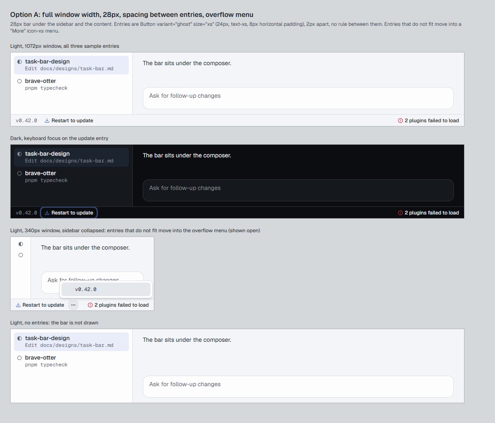
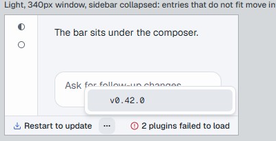
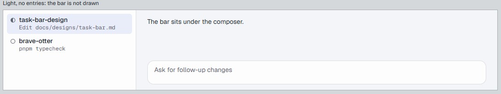
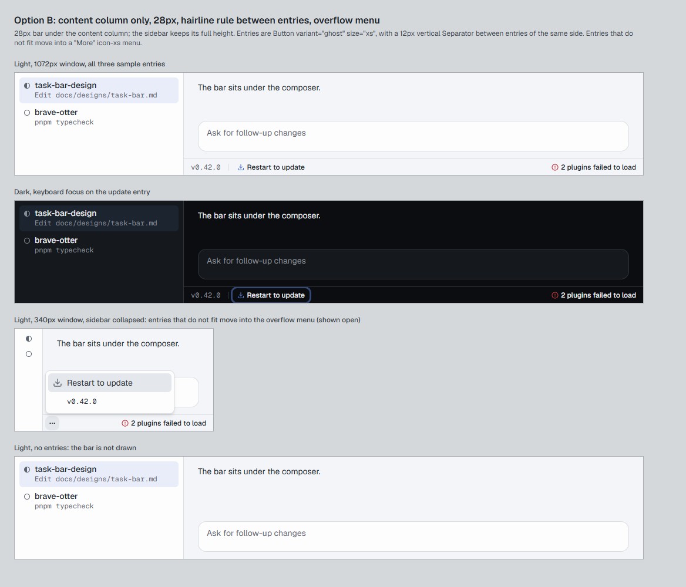
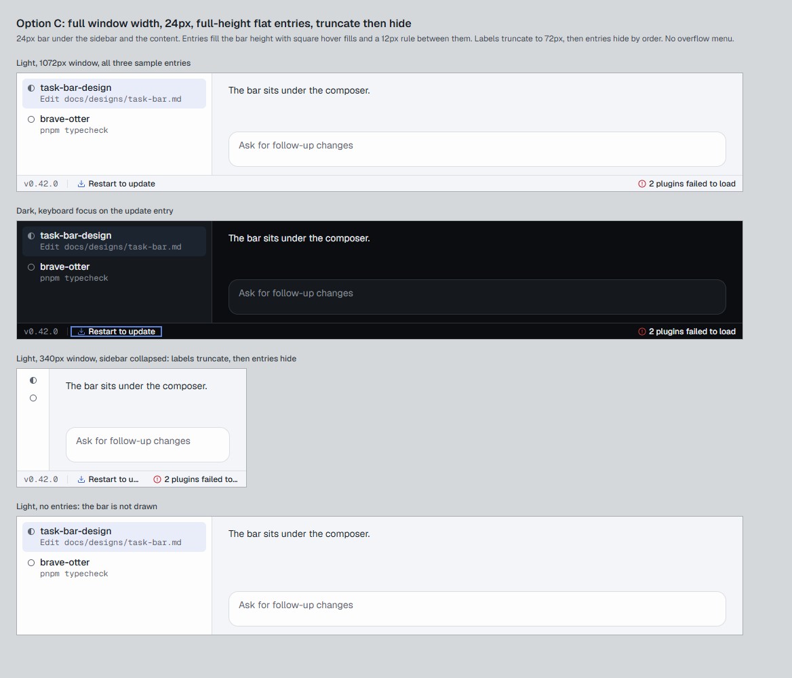

# Task bar

Issue `248ef418-109e-464d-8d10-b27fe9e2aaab`, objective "Add a task bar at the bottom of the dia app". This document is the visual spec for the task bar: a one-line strip along the bottom of the window that shows information about dia and entries that plugins add. It covers what the bar looks like and how it behaves at every width. Which slot plugins use to add entries, and the entry type, belong to the task bar ADR; this spec assumes only that an entry has a `side` (`start` or `end`), an `order` number, a label, an optional icon, an optional tooltip and an optional action.

The user chose option A on 2026-11-25 from the three rendered options below.



## Decisions

| Decision | Choice |
|---|---|
| Placement | Full window width, under both the sidebar and the content column |
| Height | 28px including its 1px top border (`h-7`) |
| Entry | The existing `Button` with `variant="ghost"` `size="xs"`: 24px tall, `text-xs`, 8px horizontal padding, 4px between icon and label, 12px icon, 8px corners |
| Separator between entries | None. Entries sit 2px apart (`gap-0.5`); the ghost button's own padding separates the labels |
| Too many entries | Hide entries by `order`, highest first, into one `…` overflow menu |
| No entries | The bar is not drawn and takes no height |

## Anatomy

```
┌ sidebar ───────────┬ content ───────────────────────────────────────────┐
│                    │                                                    │
├────────────────────┴────────────────────────────────────────────────────┤ 1px --border
│ v0.42.0  ⤓ Restart to update                 ⓘ 2 plugins failed to load │ 28px
└─────────────────────────────────────────────────────────────────────────┘
 ↑ 4px bar padding, then 8px entry padding: labels start 12px from the edge
```

| Part | Tailwind | Value |
|---|---|---|
| Bar | `flex h-7 shrink-0 items-center gap-0.5 border-t border-border bg-background px-1` | 28px tall, `--background`, 1px `--border` top edge, 4px left and right padding |
| Start group | `flex min-w-0 items-center gap-0.5` | Entries whose `side` is `start`, left to right |
| End group | `ml-auto flex min-w-0 items-center gap-0.5` | Entries whose `side` is `end`, pushed to the right edge, left to right |
| Entry with an action | `<Button variant="ghost" size="xs">` | 24px tall, 2px from the bar's top border and bottom edge |
| Entry without an action | `<span>` with the same classes as `Button size="xs"`, minus hover and focus | Same box, not focusable, no hover fill |
| Overflow button | `<Button variant="ghost" size="icon-xs" aria-label="More task bar entries">` with lucide `Ellipsis` | 24px square |

The bar has no drag region (`titlebar-drag` stays on the 32px top rows only, ADR-0039) and no shadow (DESIGN.md › The Flat Frame Rule).

### Order within a group

Entries in a group are sorted by `order` ascending, then by plugin name and id, the same rule as the right panel and the session rail cards. Lower `order` sits nearer the group's outer edge: the lowest-order `start` entry is leftmost, and the lowest-order `end` entry is rightmost.

## Text and colour

| Element | Light | Dark | Rule |
|---|---|---|---|
| Bar fill | `--background` `oklch(0.97 0.004 255)` | `--background` `oklch(0.16 0.008 255)` | Same as the content area |
| Bar top border | `--border` `oklch(0.9 0.006 255)` | `--border` `oklch(0.32 0.012 255)` | Hairline |
| Default label | `text-ink-muted`, `text-xs`, `font-medium` | same token | Information that needs no action |
| Label that asks for attention | `text-ink`, `text-xs`, `font-medium` | same token | An entry the user should act on, such as an update or an error |
| Hover fill | `--secondary` (Quiet Fill), label turns `text-ink` | same token | From `Button variant="ghost"` |
| Focus | `focus-visible:ring-[3px] ring-ring/50` | same | From `Button`; no scale |
| Literal values | `font-mono font-normal` | same | A version or other literal string, per the Content-Is-Mono Rule |

Colour inside an entry follows the One Voice Rule: an icon may be Error Red for an error, Needs-input Amber for a warning, or Signal Indigo for an action; a label is never coloured. No entry pulses.

## Sample entries

These three entries are the reference for anyone adding one. Their `order` values are chosen so the least important entry hides first.

| Entry | Side | `order` | Shown while | Icon | Label | Tooltip (`side="top"`) | Action |
|---|---|---|---|---|---|---|---|
| App version | `start` | 20 | Always | none | `v0.42.0`, mono, `text-ink-muted` | `About dia` | Opens the About dialog |
| Update available | `start` | 10 | `UpdateStatus` is `UpdateReady` | lucide `Download`, `text-primary` | `Restart to update`, `text-ink` | `Version 0.43.0 is ready to install.` (the About dialog's wording) | Calls `window.dia.installUpdate()`, the same call as the About dialog's `Restart to update` button |
| Plugin load errors | `end` | 0 | One or more plugins failed to load | lucide `CircleAlert`, `text-error` | `1 plugin failed to load` or `2 plugins failed to load`, `text-ink` | The failed plugins' names in mono, comma-separated: `dia-git, dia-cost` | Opens Settings › Plugins |

`0.42.0` and `0.43.0` stand in for the values `getAppVersion()` and `UpdateReady.version` return.

## Overflow



1. Lay out every entry at its full width. Labels never truncate.
2. While the entries do not fit the bar, hide the visible entry with the highest `order`, from either side. Ties hide the entry that sorts last by plugin name and id.
3. When at least one entry is hidden, show the overflow button directly after the last visible `start` entry. Its own 24px counts towards the width in step 2.
4. The overflow button opens a `DropdownMenu` with `side="top"` and `align="start"`. It lists the hidden entries in `order` ascending, each as its icon (16px, `text-ink-muted` unless the entry colours it) and its label at menu size (`text-sm`; a mono label stays mono at `text-xs`). Selecting an item runs the entry's action. An entry without an action is listed as a non-selectable row in `text-ink-muted`.
5. Measure again whenever the bar's width or the set of entries changes (a `ResizeObserver` on the bar). An entry that fits again leaves the menu and returns to its place. The overflow button disappears when the menu would be empty.

| Window | Visible in the bar | In the `…` menu |
|---|---|---|
| 1072px, sidebar open | `v0.42.0`, `Restart to update`, `2 plugins failed to load` | nothing; no `…` |
| 340px, sidebar collapsed | `Restart to update`, `…`, `2 plugins failed to load` | `v0.42.0` |
| 160px | `…` | `2 plugins failed to load`, `Restart to update`, `v0.42.0` |

## No entries

When no entry is shown, the bar is not rendered: the sidebar and the content column reach the bottom of the window, as they do today. There is no placeholder text and no empty 28px strip. The bar appears and disappears without animation.



## Keyboard focus order

The bar comes last in the DOM of the window frame, after the content column, so `Tab` reaches it after the composer and the content area, and `Shift Tab` from the first bar entry returns to the content.

| Step | Focus |
|---|---|
| 1 | Each `start` entry with an action, left to right |
| 2 | The overflow button, while it is shown |
| 3 | Each `end` entry with an action, left to right |

Entries without an action, and hidden entries, are not tab stops. Every entry with an action is one tab stop: the bar uses no arrow-key navigation. `Enter` and `Space` run the focused entry's action. The bar is a `<footer aria-label="Task bar">`. An icon-only entry needs an `aria-label`; the overflow button's is `More task bar entries`.

## Constraint for the engineer

The shadcn sidebar container is `fixed inset-y-0 h-svh` (`src/renderer/src/components/ui/sidebar.tsx:209`), so it covers the full window height and would draw over the left part of a full-width bar. While the bar is shown, the sidebar container must end at the bar's top edge, for example with a `--task-bar-height` custom property (28px while the bar is shown, 0 when it is not) that sets the container's `bottom` instead of `inset-y-0` and `h-svh`. `SidebarProvider` in `plugins/dia-layout/layout.tsx` already overrides `min-h-svh` with `h-full min-h-0`; the bar sits after it in a `flex flex-col h-full` column.

## Rejected options

Both were rendered with the same sample entries and states as option A.

### Option B: content column only, 28px, hairline rules, overflow menu



The bar spans only the content column, and the sidebar keeps its full height, so the sidebar code needs no change. A 12px vertical `Separator` sits between entries on the same side. Rejected: the bar is narrower than option A's by the sidebar's width (224px to 512px), so entries move into the overflow menu at a wider window. In a 1072px window with the sidebar at its default 288px, option B's bar is 783px wide and option A's is 1072px.

### Option C: full width, 24px, flat full-height entries, truncate then hide



Entries fill the full 24px height with square hover fills, separated by 12px rules. Labels truncate to 72px, then entries hide, with no overflow menu. Rejected: a hidden entry cannot be reached at all; truncation removes the meaning of an error (`2 plugins failed to…`); the entry needs a custom component instead of `Button size="xs"`; and square corners contradict DESIGN.md › Shapes ("Nothing uses a sharp 0px corner").

## Render sources

`task-bar/option-a.html`, `task-bar/option-b.html` and `task-bar/option-c.html` draw the frames with `task-bar/mock.css` and `task-bar/mock.js`, using the theme values from `src/renderer/src/index.css`. They load the Geist fonts from `node_modules` relative to the main checkout. To render them again:

```sh
impeccable shot docs/designs/task-bar/option-a.html --viewport 1168x1000 --full --out <dir>
```
